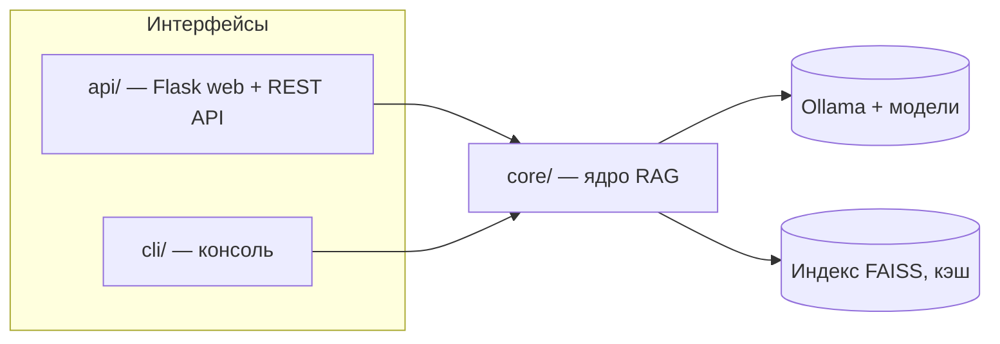

# RAG системы

Репозиторий содержит RAG-систему поиска по документам (`.doc`, `.docx`, `.pdf`),
разделённую на **общее ядро** и два **независимых интерфейса**.

## Структура

```
RAG systems/
├── core/   # Ядро RAG-системы (без UI): движок LlamaIndex+FAISS, парсеры, хэши, настройки
├── api/    # Web-интерфейс + REST API (Flask) поверх core
├── cli/    # Консольный интерфейс (интерактивное меню) поверх core
├── README.md
└── ...     # прочие рабочие файлы и скрипты проекта
```



## Возможности

- Инкрементальная синхронизация индекса по файлам (по хэшам).
- Парсинг `.doc` (Word COM), `.docx` (python-docx), `.pdf` (ABBYY FineReader OCR).
- Два режима поиска: перебор по ключевым словам без ИИ и RAG-поиск с ИИ.
- Управление моделями Ollama, чанками, папками через web-админку, REST API или консоль.

## Требования

- Windows (парсеры используют COM Word и ABBYY FineReader 15 для `.doc`/`.pdf`).
- Запущенный сервер Ollama с установленными моделями (см. `core/settings.json`).
- Python 3.10+ (используется синтаксис `X | None`, `list[str]`).

## Установка

```powershell
# из корня проекта «RAG systems»
pip install -e ./core
pip install -r ./api/requirements.txt
```

> Пакет `core` ставить не обязательно — `api/app.py` и `cli/cli.py` сами добавляют
> корень проекта в `sys.path`. Установка нужна для импорта `core` из произвольных
> каталогов.

## Запуск

### Web + REST API

```powershell
python api/app.py                 # порт 80 (может требовать права администратора)
$env:RAG_PORT = 8080; python api/app.py   # другой порт
```

### Консоль

```powershell
python cli/cli.py
```

## Документация

- [core/README.md](core/README.md) — ядро: настройки, кэш, API.
- [api/README.md](api/README.md) — запуск web, таблица REST-эндпоинтов.
- [cli/README.md](cli/README.md) — консольное меню.