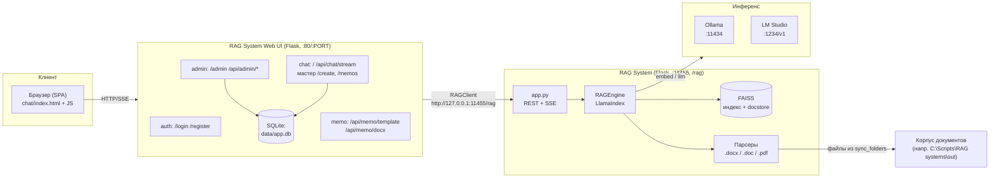
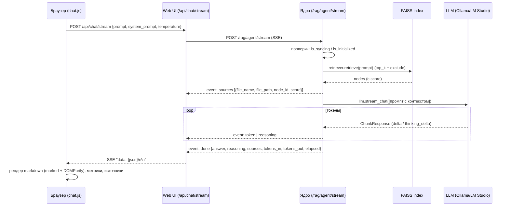
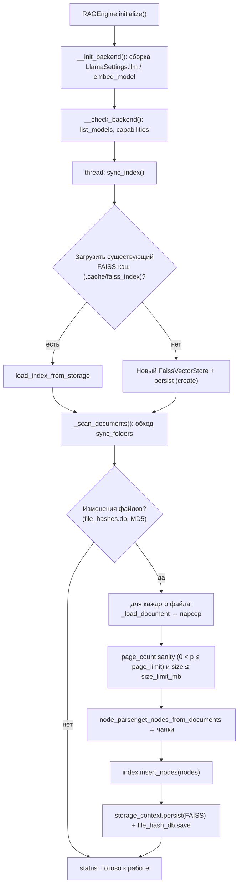
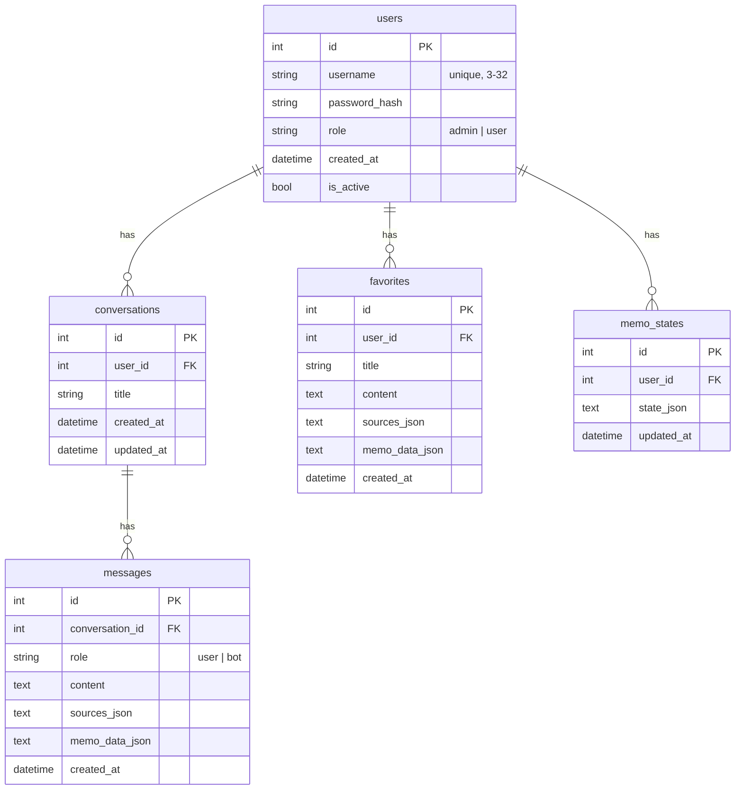
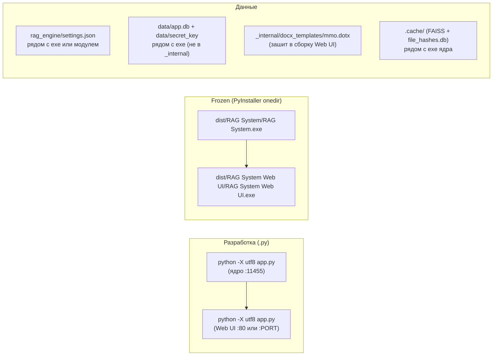

# 01. Архитектура

## 1.1 Обзор

Система — классический RAG-стек (Retrieval-Augmented Generation): документы индексируются в векторную базу, по запросу извлекаются релевантные фрагменты, и LLM формирует ответ с опорой только на них.



**Ключевое правило:** Web UI **не** читает корпус `out/` напрямую и не держит кэши документов. Вся логика индексации, поиска и генерации живёт в ядре; Web UI лишь проксирует запросы через `RAGClient` (`api_client.py`) и стримит SSE в браузер.

## 1.2 Запуск и порядок

Сначала ядро, потом Web UI (порт 80 проксирует `/rag/*` на ядро):

```powershell
& "C:\Scripts\RAG systems\RAG System\.venv\Scripts\python.exe" -X utf8 app.py
& "C:\Scripts\RAG systems\RAG System Web UI\.venv\Scripts\python.exe" -X utf8 app.py
```

- `-X utf8` обязателен у обоих приложений (иначе ломается кириллица в `.docx`).
- Адрес ядра Web UI берёт из `RAG_API_URL` (по умолчанию `http://127.0.0.1:11455/rag`).
- Порт Web UI — env `PORT` (по умолчанию 80, требует прав администратора).
- Web UI при первом запуске создаёт `data/app.db` (SQLite) и пользователя `admin` с паролем из `DEFAULT_ADMIN_PASSWORD` (по умолчанию `admin123`).

## 1.3 Поток запроса в чате (SSE)



События SSE: `sources`, `reasoning` (thinking), `token`, `done`, `error`.

## 1.4 Поток индексации (фоновый поток ядра)



Особенности:

- Обработка файлов **строго последовательная** (`for rel_path in new_or_modified`) — параллельные `insert_nodes` + `persist` в один FAISS-файл зависают/портят индекс.
- Инкрементальность по MD5-хэшу (таблица `file_hashes` в SQLite `.cache/file_hashes.db`).
- `reset=true` (`POST /rag/index?reset=true`) — очистка кэша и полная пересинхронизация.
- В frozen-режиме `.cache` создаётся рядом с exe (`Path(sys.executable).parent/.cache`).

## 1.5 Поток поиска записок (`/memos`)

Поиск **всех** служебных записок по теме с полным текстом. Использует постраничный обход индекса без повторов:

```mermaid
flowchart LR
    A["prompt по теме"] --> B["Извлечь корни слов темы\n(_memo_topic_words)"]
    B --> C["Гибридный отбор кандидатов"]
    C --> D1["Имя-фильтр: файлы, в названии которых есть корни\n(идут первыми, полными чанками)"]
    C --> D2["Семантический ретрив: retriever.retrieve(prompt)\n(доки по смыслу, не отражённые в имени)"]
    D1 --> E["candidate_pairs: [(file_path, node)]"]
    D2 --> E
    E --> F{"for page in 1..max_pages"}
    F -->|батч page_size чанков| G["Батч-LLM (stream_chat)\nс системным промптом _MEMO_BATCH_SYSTEM_PROMPT"]
    G --> H["reasoning стримится пользователю"]
    G --> I["Парсинг ответа: строки 'ПУТЬ: <путь>'"]
    I --> J{"В батче есть новые пути?"}
    J -->|да| K["добавить в found_paths, перейти к след. батчу"]
    J -->|"нет / 'НОВЫХ ЗАПИСОК НЕТ'"| L["Завершить"]
    L --> M["Сборка полного текста из docstore\n(_assemble_document_text по start_char_idx)"]
    M --> N["done: {documents, pages, tokens_in/out, elapsed}"]
```



Ключевые параметры: `page_size=50`, `max_pages=15`. Повторы исключаются через `node_ids` (множество `seen_ids`), а для постраничности используется подход с `exclude_node_ids` (см. `_ExcludeNodeIdsPostprocessor`).

## 1.6 Схема БД Web UI



## 1.7 Развёртывание



Особенности frozen-режима:

- Ядро: `config_dir()` → рядом с exe (settings.json), `.cache` → рядом с exe.
- Web UI: `hook_runtime.py` выставляет `MEMO_TEMPLATE_DIR=<exe_dir>/_internal/docx_templates`, `DATABASE_URL=sqlite:///<exe_dir>/data/app.db`, `SECRET_KEY_FILE=<exe_dir>/data/secret_key`.
- Не бандлится `out/` (корпус), `data/`, настройки — всё создаётся при первом запуске.

## 1.8 Ограничение: Word COM

Все обращения к Word COM (конвертация `.doc`, подсчёт страниц `.docx`, генерация корпуса) **сериализованы** общим локом `_WORD_LOCK` в `docx_parser.py`. Параллельные `Dispatch("Word.Application")` из нескольких потоков заставляют Word зависать, поэтому нельзя добавлять параллельный Word-код. Тестируется только на Windows с установленным Word (CI без Word невозможен).