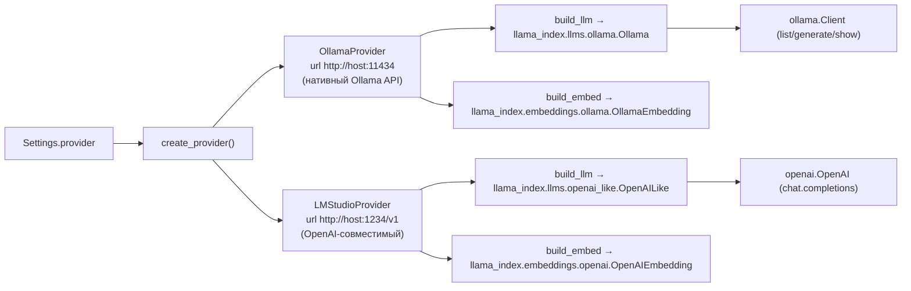

# 02. Ядро RAG System

Папка: `C:\Scripts\RAG systems\RAG System` (свой `.venv`).

## 2.1 Состав

```
RAG System/
├── app.py                  # Flask API-сервис (префикс /rag), запуск engine.initialize()
├── build.spec              # PyInstaller onedir-сборка
├── hook_runtime.py         # UTF-8 для stdout/stderr в frozen-режиме
├── pytest.ini              # testpaths, -q
├── requirements.txt        # flask, llama-index, faiss, парсеры, pytest
├── rag_engine/
│   ├── __init__.py
│   ├── config.py           # Settings (dataclass) + settings.json
│   ├── providers.py        # OllamaProvider / LMStudioProvider / create_provider
│   ├── rag_engine.py       # RAGEngine: индексация + поиск + memos
│   ├── docx_parser.py      # .docx → Markdown, Word COM (страницы), _WORD_LOCK
│   ├── doc_parser.py       # .doc → .docx (COM) → Markdown
│   ├── pdf_parser.py       # .pdf → ABBYY FineReader 15 → .docx → Markdown
│   └── file_hash_manager.py# SQLite-таблица MD5-хэшей файлов
└── tests/                  # pytest (см. doc 09)
```

## 2.2 `config.py` — Settings

`Settings` — dataclass, сохраняемая в `rag_engine/settings.json` (файл в `.gitignore` — локальная конфигурация). Путь файла: `config_dir() / "settings.json"`.

```python
config_dir():  # frozen → рядом с exe; иначе рядом с модулем rag_engine/
```

| Поле | По умолчанию | Примечание |
|---|---|---|
| `provider` | `ollama` | `ollama` \| `lmstudio` |
| `context_window` | `4096` | окно LLM (в локальном settings.json 32768) |
| `chunk_size` | `256` | размер чанка |
| `chunk_overlap` | `50` | перекрытие чанков |
| `similarity_top_k` | `10` | сколько фрагментов в ретрив |
| `page_limit` | `10` | макс. страниц документа |
| `size_limit_mb` | `5` | макс. размер файла, МБ |
| `embedding_dim` | `768` | размерность эмбеддингов (важно для FAISS) |
| `llm` | `qwen3:4b` | поколение модель |
| `llm_embed` | `nomic-embed-text-v2-moe:latest` | эмбеддинг-модель |
| `llm_keywords` | `llama3.2:3b` | модель ключевых слов |
| `url` | `http://127.0.0.1:11434` | адрес API провайдера |
| `api_key` | `""` | для OpenAI-совместимых (у LM Studio не важен) |
| `sync_folders` | `[]` | папки для сканирования |

Методы: `save()` (атомарно через `.tmp` + `replace`), `to_dict()`, `update(**kwargs) -> list изменённых ключей` (сохраняет только при реальных изменениях).

> Локальный `settings.json` на момент написания: `provider=lmstudio`, `url=http://127.0.0.1:1234/v1`, `llm=qwen3.8-4b-distill`, `llm_embed=text-embedding-nomic-embed-text-v1.5`, `sync_folders=["C:\Scripts\RAG systems\out"]`.

## 2.3 `providers.py` — абстракция над инференсом

Единый интерфейс `BaseProvider`:

- `build_llm(model, context_window, temperature)` → объект LlamaIndex (streaming).
- `build_embed_model(model)` → эмбеддинги LlamaIndex.
- `generate_text(model, prompt)` → однопроходная генерация (для ключевых слов).
- `list_models() -> list[str]` — список моделей бэкенда.
- `is_available()` / `capabilities(model, cap)`.



Таймауты (важно для админки):

- `_PROBE_TIMEOUT = httpx.Timeout(connect=3, read=8, write=8, pool=3)`, `_PROBE_MAX_RETRIES = 1` — быстрый отказ при недоступном бэкенде (иначе смена провайдера через админку зависает на десятки секунд).
- `_GENERATE_TIMEOUT = 600.0` — щедрый таймаут реальной генерации.

`LMStudioProvider.capabilities`: распознавание эмбеддинговых моделей **по имени** (`_EMBED_MODEL_HINTS`: `embed`, `bge`, `mxbai`, `gte-`, `e5-*`, `nomic-embed`). Для Ollama — по нативным `capabilities` (`ollama show`).

## 2.4 Парсеры

### `docx_parser.py`
- `DocxParser(file_path)`: открывает через `python-docx`, обходит `doc.element.body`, сохраняя структуру (заголовки `Heading 1..3`, списки `- `, таблицы → Markdown-таблицы). Изображения игнорируются.
- `DocxParser.get_page_count(path)`: подсчёт страниц через Word COM (`doc.Content.Information(4)`), сериализован `_WORD_LOCK`, COM-апартмент инициализируется один раз на поток (`_ensure_com`/`_teardown_com`).
- `parse(check_page_count=True)`: если `page_count == 0 or page_count > 10` → вернёт `(page_count, None)`.

### `doc_parser.py`
- `DocParser.parse()`: под `_WORD_LOCK` открывает `.doc`, `SaveAs2(docx, FileFormat=16)` (wdFormatXMLDocument) во временный файл, парсит через `DocxParser`. Временный файл удаляется.

### `pdf_parser.py`
- `PdfParser.parse()`: конвертация через ABBYY FineReader 15 (`FineCmd.exe <pdf> /out <docx> /lang Russian+English /quit`), затем парсинг через `DocxParser`.
- `get_page_count()`: `PyPDF2.PdfReader` — число страниц без OCR.
- Жёсткий путь: `C:\Program Files (x86)\ABBYY FineReader 15\FineCmd.exe`. Если FineReader нет — `RuntimeError`.

## 2.5 `file_hash_manager.py`

SQLite-хранилище MD5-хэшей файлов по полному пути (таблица `file_hashes(path PK, hash, modified)`). Используется для инкрементальной синхронизации. `check_same_thread=False`, методы `save/get/remove/get_all_paths/get_all_hashes/exists/close`. `close()` обязателен перед `shutil.rmtree(cache_dir)` при сбросе.

## 2.6 `rag_engine.py` — RAGEngine

`VERSION = "26.09.22"`.

### Конструктор
- Задаёт `.cache_dir` (frozen → рядом с exe; иначе `.cache` в cwd).
- `node_parser = SentenceSplitter(chunk_size, chunk_overlap, paragraph_separator="\n\n\n")`.
- `file_hash_db = FileHashManager(.cache/file_hashes.db)`.
- `provider = create_provider(...)`.
- Поля статуса: `status_backend`, `backend_models{,_thinking,_embed}`, `is_syncing`, `is_initialized`, `sync_status`, `sync_progress`, `sync_file`, `items_processed`, `avg_time_per_item`.
- `cfg.save()` при старте.

### Синхронизация (`sync_index`)
Описана в документе 01 (раздел 1.4). Методы: `_scan_documents()` (обход, фильтр форматов `.doc/.docx/.pdf`, пропуск `~*`, `*.tmp`, размер > `size_limit_mb`), `_load_document()`, `_remove_nodes_for_files()`. Возвращает `(new_or_modified, [], current_hashes)` — удаление файлов сейчас не детектируется (deleted всегда `[]`).

### Инициализация моделей
`__init_backend()`: `LlamaSettings.llm = provider.build_llm(cfg.llm, cfg.context_window, temperature=0.98)`, `embed_model = provider.build_embed_model(cfg.llm_embed)`.

`__check_backend()`: `list_models()`; при недоступном бэкенде очищает списки моделей (чтобы админка не показывала устаревшие) и `status_backend=False`.

`initialize()`: `__init_backend()` → `__check_backend()` → поток `sync_index`.

### `agent_stream(...)` — SSE-генератор ответа
Логика (см. схему 01, раздел 1.3):

1. Проверки: `is_syncing` → error «Идет синхронизация»; `is_initialized/index is None` → error «Индекс не готов»; пустой `prompt` → error.
2. Ретрив с запасом: `retrieval_top_k = top_k + len(exclude_node_ids)`, ручное исключение уже отданных `node_id`, срез до `top_k`.
3. Сразу отдаётся событие `sources` (до токенов): `[{file_name, file_path, node_id, score}]`.
4. Упаковка контекста под окно: `max_chars = (context_window - 512) * 4`, жёсткая сборка промпта («Системная инструкция … Контекстная информация … Запрос …»).
5. Стриминг через `llm.stream_chat([ChatMessage(USER, prompt_text)])`: `token` = `resp.delta`, `reasoning` = `resp.additional_kwargs["thinking_delta"]` (поддерживает и OpenAI-совместимые reasoning-модели, и Ollama).
6. Метрики в `done`: `tokens_in` (tiktoken `cl100k_base`, fallback len/4), `tokens_out`, `elapsed` (сек). `_count_tokens()` в `rag_engine.py`.
7. `error` — на исключение.

### `memos` / `memos_stream` — поиск всех записок
Детально в документе 01 (раздел 1.5). Ключевые помощники:

- `_memo_topic_words(prompt)` — стоп-слова (`_MEMO_STOP_WORDS`), корни до 5 символов для фильтра по именам файлов (`канцелярск` + `канцелярских`).
- `_memo_file_match(name, roots)` — подстрока корня в имени файла (дёшевый предфильтр до LLM).
- `_MEMO_BATCH_SYSTEM_PROMPT` — промпт батча, просит вернуть только `ПУТЬ: <полный путь>` по строкам или ровно «НОВЫХ ЗАПИСОК НЕТ».
- `_index_nodes_by_path()` — `file_path -> [nodes]` из docstore (O(N), узлы сортируются по `start_char_idx`).
- `_assemble_document_text(path, nodes)` — полный текст через start_char_idx, перекрытия (`chunk_overlap`) вырезаются. Файлы повторно не парсятся, Word COM не задействуется.

### Управление конфигом во время работы

`update_config(**kwargs) -> {"changed": [...]}`:
- смена `provider` без явного `url` → подставляет `DEFAULT_URLS[новый provider]`, если url был дефолтом старого;
- `chunk_size/chunk_overlap` → обновляет node_parser;
- `restart_index` при изменении `chunk_size, chunk_overlap, llm_embed, embedding_dim` → `start_sync(is_remove=True)` (пересоздание индекса!);
- `restart_llm` при `llm, llm_embed, llm_keywords, provider, url, api_key` → `__init_backend()` + `__check_backend()`;
- `_autofix_models_for_provider(kwargs)` — если бэкенд ответил и пользователь не указывал модель явно, подставляет первую доступную thinking/embedding модель.

### Статус и метаданные
- `get_status()` — `is_initialized, is_syncing, status, progress, status_backend, document_count, sync_files, index_updated, version`.
- `get_document_count()` — `len(file_hash_db.get_all_paths())`.
- `get_data_bd()` — mtime `faiss_index/graph_store.json` (человекочитаемая дата «индекс обновлён»).

## 2.7 `app.py` — HTTP-слой

См. полное описание API в документе `04-api-core.md`. Запуск:

```python
if __name__ == "__main__":
    engine.initialize()
    app.run(debug=False, host="0.0.0.0", port=11455, use_reloader=False)
```