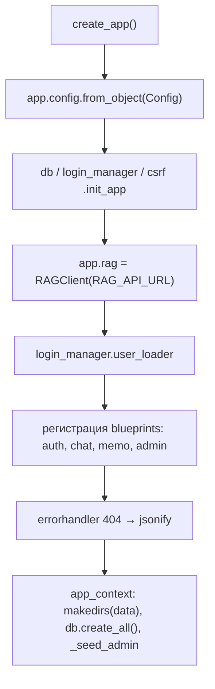
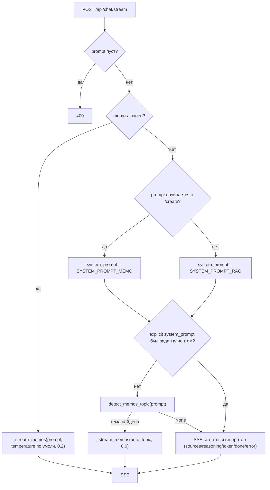
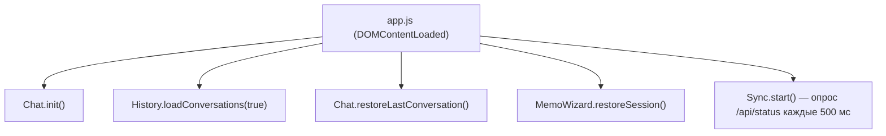

# 03. RAG System Web UI

Папка: `C:\Scripts\RAG systems\RAG System Web UI` (свой `.venv`).

## 3.1 Состав

```
RAG System Web UI/
├── app.py            # create_app(), регистрация blueprints, _seed_admin
├── config.py         # Config (env-переменные, промпты, MEMO_JS_VERSION)
├── extensions.py     # db, login_manager, csrf
├── models.py         # User, Conversation, Message, Favorite, MemoState, Notification, NotificationDismissed, AdminMessage
├── auth.py           # /login /register /logout
├── chat.py           # / и /api/chat/stream, conversations, messages, favorites, /api/status, /api/parse,
│                     # /api/schedule, /api/notifications, /api/feedback, /api/password
├── schedule.py       # get_restriction_message() — проверка запрета через ядро (applies_now)
├── memo.py           # /api/memo/template, /api/memo/state, /api/memo/docx, админ-шаблон
├── memo_docx.py      # генерация .docx по mmo.dotx, discover_template_fields
├── admin.py          # /admin + /api/admin/*
├── api_client.py     # RAGClient — обёртка над RAG API (REST + SSE)
├── build.spec        # PyInstaller onedir
├── hook_runtime.py   # frozen: MEMO_TEMPLATE_DIR, DATABASE_URL, SECRET_KEY_FILE
├── requirements.txt  # flask, sqlalchemy, login, wtf, requests, python-docx, pytest
├── templates/        # base, chat/index, admin/index, auth/{login,register}
├── static/
│   ├── css/          # bootstrap.min.css, bootstrap-icons.css, style.css
│   └── js/           # bootstrap.bundle, marked.min, dompurify.min,
│                     # utils, history, chat, sync, memo, notifications, app, admin
├── data/             # app.db, secret_key (в .gitignore)
└── tests/            # conftest (FakeRAG) + test_app.py
```

## 3.2 `app.py` — фабрика приложения



`_seed_admin`: создаёт пользователя `admin` (роль `admin`) с паролем из `DEFAULT_ADMIN_PASSWORD` (по умолчанию `admin123`), если его нет.

Запуск: `port = app.config["PORT"]`, `app.run(debug=False, host="0.0.0.0", port=port, use_reloader=False)`.

## 3.3 `config.py` — Config

| Параметр | По умолчанию | Примечание |
|---|---|---|
| `SECRET_KEY` | генерируется | из `SECRET_KEY` или `SECRET_KEY_FILE` (по умолч. `data/secret_key`) |
| `SQLALCHEMY_DATABASE_URI` | `sqlite:///data/app.db` | можно переопределить `DATABASE_URL` |
| `RAG_API_URL` | `http://127.0.0.1:11455/rag` | адрес ядра |
| `PORT` | `80` | порт Web UI |
| `MEMO_TEMPLATE_DIR` | `<проект>/../docx_templates` | каталог `mmo.dotx` |
| `OPEN_REGISTRATION` | `true` | разрешить регистрацию |
| `DEFAULT_ADMIN_PASSWORD` | `admin123` | пароль seed-админа |
| `MEMO_JS_VERSION` | `"20261013-02"` | версия кэширования JS/CSS (`?v=...`) |

Системные промпты:

- `SYSTEM_PROMPT_RAG` — обычный вопрос: развёрнутый ответ по контексту, не выдумывать.
- `SYSTEM_PROMPT_MEMO` — команда `/create`: оформить как служебную записку (Кому, От, заголовок, основная часть, вывод).
- `SYSTEM_PROMPT_MEMO_VARIANTS` — для мастер-вариантов (JSON `{"variants": [...], "sources": [...]}`).
- `SYSTEM_PROMPT_MEMO_LIST` — перечисление записок (не используется в текущем коде чата; задекларирован в config).

`COMMAND_CREATE = "/create"`.

## 3.4 `extensions.py`

Синглтоны `db = SQLAlchemy()`, `login_manager = LoginManager()` (`login_view = "auth.login_page"`), `csrf = CSRFProtect()`.

## 3.5 `models.py`

См. документ `06-database.md`. Модели: `User` (password хэш, `is_admin`), `Conversation`, `Message`, `Favorite`, `MemoState`, `Notification` + `NotificationDismissed`, `AdminMessage`. Расписание запрета в SQLite **не** хранится — источник в ядре (см. `schedule.py` и 04/05).

## 3.6 `auth.py`

- `GET/POST /login` — форма, проверка `check_password`, редирект на безопасный `next`.
- `GET/POST /register` — проверки: `OPEN_REGISTRATION`, совпадение паролей, логин `[A-Za-z0-9_.-]{3,32}`, пароль ≥ 6, уникальность. Создаёт пользователя с ролью `user`, сразу логинит.
- `POST /logout` — `logout_user()`.

## 3.7 `chat.py`

### `/` — chat/index.html
`render_template("chat/index.html", user=current_user)` — единственная SPA-страница (см. 3.10).

### `POST /api/chat/stream` — главный endpoint
Перед обращением к ядру: если `get_restriction_message(current_user)` вернул текст (запрет по расписанию из ядра; админы не блокируются) → `403 {error, restricted: true}`. Далее проксирует `rag.stream_chat` / memos-SSE (см. 05).
Приоритеты выбора системного промпта и ветки:



Метрики из ядра передаются в `done` без изменений; sources дедуплицируются по `file_path` с сохранением лучшего score (`_dedupe_sources`).

### Авто-детекция поиска записок (`detect_memos_topic`)
- Не срабатывает, если запрос начинается с «обучающих» префиксов (`что такое`, `зачем нужн`, `как составить`, `как написать`, `какие бывают`, `виды`) — это вопрос о сути, а не поиск.
- Маркеры темы: `служебн`, `записк`, `мемо`, `служебк`.
- Из оставшихся слов отбрасываются стоп-слова (`найди`, `поиск`, `покажи`, `подбери`, `дай`, `все`, `нужно`, `для`, `о`, `об`, `по`, `про`, `теме`, `тема` и др.).
- Срабатывает **только** для обычных вопросов (без явного `system_prompt`) — чтобы мастер `/create` не перехватывался.

### `_stream_memos(rag, prompt, temperature)`
- Если у `rag` есть `memos_stream` → стримится `reasoning` + финальный `done` с `documents`, метриками.
- Fallback: `rag.memos()` (одним запросом, с тем же форматом ответа).
- Собирает текст `_memos_answer(documents, prompt)`: заголовки `### имя`, «Документ: путь», полный текст, «**Итого записок по теме: N**».

### Остальные endpoints
- `GET /api/conversations` (пагинация `page/per_page`, по `updated_at desc`), `POST` (создание с title/Новый диалог), `GET/PUT/DELETE /api/conversations/<cid>` (проверка владельца `user_id`).
- `POST /api/messages` — создание сообщения (role, content, sources_json, memo_data_json); `skip_touch=true` не трогает `updated_at` диалога.
- `GET/POST /api/favorites`, `DELETE /api/favorites/<fid>`.
- `GET /api/status` → `current_app.rag.index_status()` + `restricted`/`restriction_message` (блокировка для не-админов).
- `GET /api/schedule` → данные расписания ядра + флаг блокировки текущего пользователя.
- `GET /api/notifications`, `POST /api/notifications/<nid>/dismiss` — уведомления с отметками о закрытии.
- `POST /api/feedback` (`{text}` ≤2000 симв.) — сообщение администратору.
- `POST /api/password` — смена собственного пароля.
- `POST /api/parse` → `rag.parse_file(file_path)`.

## 3.8 `memo.py` и `memo_docx.py`

См. документ `07-memo-wizard.md`. Кратко:

- `GET /api/memo/template` — поля шаблона (key/label/hint), путь, mtime.
- `GET/POST/DELETE /api/memo/state` — сохранение состояния мастера на сервере (SQLite `memo_states`), не localStorage.
- `POST /api/memo/docx` — генерация и отдача `sluzhebnaya_zapiska.docx`.
- `POST /api/admin/memo/template/reload`, `POST /api/admin/memo/template` (upload .dotx) — только admin.

## 3.9 `admin.py`

`/admin` рендерит `admin/index.html` с данными: версия движка, число документов, индекс updated, провайдер, модели (all/thinking/embedding), конфиг.

API (все требуют `login_required` + `admin_required`, исключая только сам просмотр):

| Endpoint | Действие |
|---|---|
| `GET /api/admin/info` | статус движка + бэкенда |
| `GET /api/admin/config`, `PATCH /api/admin/config` | чтение/обновление конфига RAG |
| `POST /api/admin/config/reset` | сброс конфига + пересинхронизация |
| `GET /api/admin/models` | список моделей бэкенда |
| `GET/POST /api/admin/provider` | провайдер |
| `GET/POST /api/admin/folders` | папки синхронизации |
| `POST /api/admin/sync` | запуск синхронизации (`reset`) |
| `GET/POST /api/admin/users`, `DELETE /api/admin/users/<uid>`, `PUT /api/admin/users/<uid>/password` | пользователи (нельзя удалить админа) |
| `GET/POST /api/admin/schedule`, `PUT/DELETE /api/admin/schedule/<rid>` | прокси ядра `/rag/schedule` (валидация на ядре) |
| `GET/POST /api/admin/notifications`, `DELETE /api/admin/notifications/<nid>` | уведомления для пользователей |
| `GET /api/admin/messages`, `POST /api/admin/messages/<mid>/read`, `DELETE .../<mid>` | обратная связь от пользователей |

`admin_required` — декоратор, возвращающий `403` для не-админов.

## 3.10 Фронтенд (templates + static/js)

Страница чата подключает (порядок важен):

```
bootstrap.bundle.min.js → marked.min.js → dompurify.min.js →
utils.js → history.js → chat.js → sync.js → memo.js → notifications.js → app.js
```

Все пользовательские JS/CSS подключаются с `?v={{ config['MEMO_JS_VERSION'] }}` (антикэш).



- **utils.js**: `generateUUID`, `escapeHtml`, `formatTimeAgo`, `renderMarkdown` (marked + DOMPurify), `apiFetch`, `showToast`, `copyText`, `streamSSE` (fetch-стрим, разбор `data: {}` строк, колбэки onEvent/onDone/onError/onSources/onReasoning/onToken).
- **history.js**: пагинированная загрузка диалогов/избранного (по 50), рендер элементов, переименование/удаление, `saveAnswerToFavorites`, переключение вкладок, `clearAll` (удаляет все диалоги и избранное).
- **chat.js**: `Chat` — отправка, стриминг, команды (`/create /memos /cancel /new /clear /help`, меню команд при вводе `/`), рендер ответа (markdown), `<details>`-блок «Размышления», кнопки источников → модалка просмотра файла, метрики (`setMetrics`: «N ток. · вход M · X с»), сохранение в историю. `memoListHtml` — список записок `<details class="memo-item">` с кнопками «Скопировать путь» и «Сохр. в избранное»; `loadFavorite`, `restoreLastConversation`, `clearChat` (сбрасывает и мастер), `openFileModal/parseFile`.
- **sync.js**: оверлей синхронизации, `Chat.serverReady` управляется по `is_syncing/initialized`.
- **memo.js**: мастер записки (см. документ 07).
- **notifications.js**: опрос `/api/notifications`, баннер уведомлений, dismiss по клику/крестику.
- **admin.js**: статус, синхронизация с прогрессом, папки, пользователи, шаблон мемо, конфиг-форма, расписание (прокси ядра), уведомления, обратная связь.

CSS: `static/css/style.css` — своя стилизация (чаты, memo-list, command-menu, sync-оверлей и т.д.) поверх Bootstrap 5.

## 3.11 `api_client.py` — RAGClient

Важно: Web UI **не** вызывает ядро напрямую — только через `RAGClient`.

REST-методы (все с `timeout=60`, при ошибках возвращают `{}`/`{"error": ...}`): `health`, `info`, `engine_status`, `index_status`, `index_stats`, `trigger_sync(reset)`, `get_config`, `patch_config`, `reset_config`, `list_models`, `get_provider`, `set_provider`, `get_folders`, `set_folders`, `parse_file`, `get_schedule`, `add_schedule`, `update_schedule`, `delete_schedule` (последние четыре — прокси `/rag/schedule`).

SSE-методы:

- `stream_chat(prompt, system_prompt, top_k, temperature, exclude_node_ids)` → `POST /rag/agent/stream` (`timeout=(10, 600)`), парсинг SSE в словари-события.
- `memos(prompt, temperature=.2, page_size=50, max_pages=15)` → `POST /rag/memos` (`timeout=900`).
- `memos_stream(...)` → `POST /rag/memos/stream` (`timeout=(10, 900)`).
- `parse_file_stream(file_path)` → `POST /rag/parse/stream`.

SSE-парсер `_parse_sse_line`: ожидает `data: {...}` по JSON, прочие строки игнорируются.