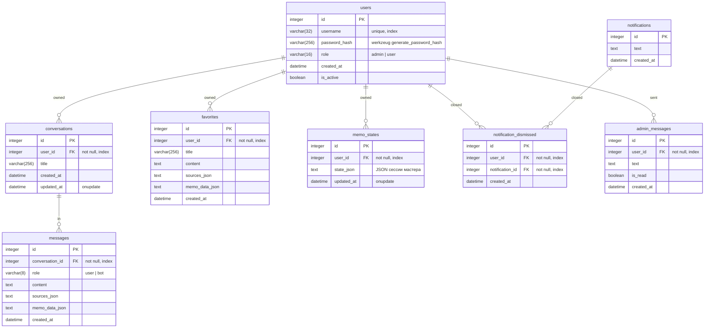

# 06. Схема БД Web UI (SQLite)

База: `data/app.db` (путь от `DATABASE_URL`, по умолчанию `sqlite:///data/app.db`). Создаётся автоматически при старте (`db.create_all()`). В frozen-режиме лежит рядом с exe (`data/app.db`).

## 6.1 Таблицы

## 6.2 Сущности (`models.py`)

### `User(UserMixin, db.Model)` — таблица `users`
- `username` — уникальный, 3–32 символа, только `[A-Za-z0-9_.-]`.
- Пароль хэшируется `werkzeug.security.generate_password_hash`, проверка `check_password`.
- `role`: `admin`/`user`; свойство `is_admin` = `role == "admin"`.
- Связи: `conversations`, `favorites` (lazy=dynamic, cascade delete-orphan).
- `to_dict()`: id, username, role, created_at (без пароля).

### `Conversation` — таблица `conversations`
- Диалог одного пользователя; `title` (используется как первый вопрос).
- `updated_at` обновляется автоматически (onupdate); сообщения каскадно удаляются.

### `Message` — таблица `messages`
- `role`: `user`/`bot`.
- `sources_json` — сериализованный список источников (`[ {file_name, file_path, score} ]`).
- `memo_data_json` — список документов записок (`[ {file_name, file_path, text} ]`), чтобы восстановить свёрнутый список `/memos`.
- `to_dict()` десериализует JSON.

### `Favorite` — таблица `favorites`
- Модель верхнего уровня (не зависит от диалогов).
- Как Message, но с собственным `title` (например «Служебная записка: Тема»).

### `MemoState` — таблица `memo_states`
- Состояние мастера служебной записки **на сервере** (в отличие от старого localStorage-подхода). Пока мастер активен, шаги и поля сохраняются сюда, чтобы перезагрузка страницы не теряла сессию.
- Поля состояния: `ts, step, topic, variants, chosen, fieldOptions, fields, fieldDefsNoBody, keys`.

> **Расписание запрета (usage_restrictions)** в SQLite Web UI больше не хранится: единый источник — ядро RAG, `Settings.usage_restrictions` в `rag_engine/settings.json` (см. doc/04, раздел «Расписание ограничений»). Web UI только проксирует `/rag/schedule`.

### `Notification` — таблица `notifications`
- Уведомление администратора; показывается пользователям сверху и скрывается по клику/крестику (запись в `notification_dismissed`).

### `NotificationDismissed` — таблица `notification_dismissed`
- Отметка, что пользователь закрыл уведомление (`UniqueConstraint(user_id, notification_id)`).

### `AdminMessage` — таблица `admin_messages`
- Сообщение пользователя администратору (об ошибке / обратная связь): `text`, `is_read`, `created_at`; автор — `user_id` (каскадно удаляется вместе с пользователем).

## 6.3 Отношения (правила)

- владелец данных — `user_id`;
- все CRUD-эндпоинты фильтруют по `current_user.id` (чужой доступ → 404);
- удаление `conversation` каскадно удаляет `messages`;
- нельзя удалить аккаунт `admin` через API (403/400);
- пароль не попадает в API-ответы (`to_dict` без `password_hash`).

## 6.4 Примечания по проектированию

- Данные Web UI (SQLite) и файлы ядра (`.cache/*`) независимы: история чата не восстанавливается из индекса — только из БД.
- При перезапуске Web UI `data/app.db` сохраняется (кроме fresh/deploy, если папки данных нет в сборке).