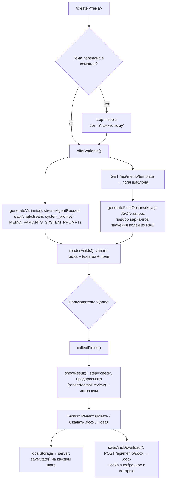
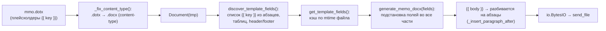

# 07. Мастер служебной записки `/create` и шаблон `mmo.dotx`

## 7.1 Что это

Из чата команда `/create <тема>` открывает пошаговый мастер:

1. **Тема** → ядро генерирует **3–5 вариантов текста** записки (RAG-промптом, JSON).
2. **Поля** → выбирается вариант тела, подставляются значения шапки (Кому/От/ФИО и т.д.) — варианты подбирает RAG, ручные поля (дата, номер) — вручную.
3. **Проверка** → предпросмотр, скачивание `.docx` и сохранение в избранное/историю.

## 7.2 Поток мастера



Состояние мастера хранится **на сервере** (`MemoState`), а не в localStorage: `saveState()` вызывается на каждом изменении (выбор варианта, ввод полей, шаги). При перезагрузке страницы `restoreSession()` восстанавливает шаг (`fields`/`check`) и продолжает с того же места.

Выход из мастера: команды `/cancel` или `/new`; `clearChat()` тоже сбрасывает мастер.

## 7.3 JSON-промпты мастера

### Варианты текста (`MEMO_VARIANTS_SYSTEM_PROMPT`)
Промпт формируется в `static/js/memo.js`:
```
"Служебная записка по теме: <тема>. Подготовь несколько вариантов текста.",
system_prompt: {
  "Ты — помощник, который генерирует варианты текста служебной записки.
   ... Верни ОДИН JSON-объект вида {"variants": [...], "sources": [{"file_name","file_path"}]}
   с 3–5 вариантами ... НЕ добавляй ничего, кроме JSON."
}
```
Ответ парсится `parseMemoJson()` (выделяет JSON-структуру из текста, устойчиво к обвязке) → `extractMemoVariants()` (извлекает список `{text, sources}`).

### Варианты полей (`generateFieldOptions`)
Отдельный запрос к LLM с JSON-схемой ключей:
```
{"ключ": ["вариант1", "вариант2", ...], ...}
```
Для парных полей (`recipient_position↔recipient_name`, `sender_position↔sender_short_name`, `executor↔phone`) запрашивается соответствие вариантов по индексу. В ответе очистка мусора через `normalizeFieldOptions()` (отбрасываются "xxx", департаменты в executor и т.п.). Если RAG не дал значений `executor`/`phone` — подставляются шаблонные («Иванов И.И.», «+7 (900) 123-45-67»).

## 7.4 Экран полей

- Выбор варианта тела — кнопки «Вариант 1..N» (`memo-body-pick`), текст редактируется в `<textarea id="memo-edit-body">`.
- Для каждого поля — кнопки-варианты из RAG (`memo-option`) + переключатель «ввести своё».
- `date` (ввод типа `date`, конвертация `YYYY-MM-DD ↔ DD.MM.YYYY`) и `memo_number` — только вручную.
- Подбор вариантов по клику «Предложить поля из RAG заново».
- Связки пар: выбор варианта по индексу из парного поля.

## 7.5 Предпросмотр и сборка `.docx`

Перед скачиванием формируется предпросмотр (`renderMemoPreview`):
```
Кому: <должность>
      <ФИО>
Служебная записка № <номер>/<отдел> от <дата>

<тело>

С уважением, <должность> <ФИО>
```

`POST /api/memo/docx` (тело = все поля) → `memo_docx.generate_memo_docx(fields)` → бинарный файл `sluzhebnaya_zapiska.docx`.

## 7.6 Шаблон `mmo.dotx` и `memo_docx.py`

Шаблон лежит в **корне репозитория**: `C:\Scripts\RAG systems\docx_templates\mmo.dotx` (бинарный, в git). Назначение директории: env `MEMO_TEMPLATE_DIR` (по умолчанию `<PROJECT_ROOT>/docx_templates`, где `PROJECT_ROOT` — родитель папки Web UI, т.е. корень репозитория).



### Как определяются поля
`discover_template_fields(path)` обходит **все** части документа (`_all_parts`): абзацы, все ячейки таблиц, header/footer (не связанные с предыдущим). Ищет плейсхолдеры `{{ key }}` (regex `\{\{\s*([a-zA-Z0-9_]+)\s*\}\}`) в порядке появления. Если шаблона нет или полей нет — фолбэк `DEFAULT_FIELDS`:

```
recipient_position, recipient_name, memo_number, date, body,
sender_position, sender_short_name
```

`get_template_fields()` кэширует по `mtime` — правка `mmo.dotx` в Word подхватывается **без перезапуска Web UI** (там же, где менялись плейсхолдеры).

### Справочник полей (`FIELD_LABELS` / `FIELD_HINTS`)

| Ключ | Метка (UI) | Примечание |
|---|---|---|
| `recipient_position` | Кому (должность) | |
| `recipient_name` | Кому (ФИО) | |
| `memo_number` | Номер служебной записки | вручную |
| `department` | Отдел | |
| `date` | Дата | вручную (date-input) |
| `body` | Текст служебной записки | hint: «оставьте пустым — сгенерируем по RAG» |
| `sender_position` | От (должность) | в UI «Подписывающее лицо (должность)» |
| `sender_short_name` | От (ФИО, кратко) | в UI «Подписывающее лицо (ФИО, кратко)» |
| `executor` | ФИО исполнителя | |
| `phone` | Телефон исполнителя | |

### Сборка документа
- Вход: `fields` в формате `{key: value}`.
- `_fix_content_type(TEMPLATE_PATH, tmp)` — копирует `.dotx` в `.docx` с заменой `wordprocessingml.template.main+xml` → `wordprocessingml.document.main+xml` (иначе Word откроет как шаблон).
- Для каждого абзаца/ячейки, содержащего `{{`, выполняется `substitute()` — замена `{{ key }}` на значение.
- Абзац с `{{ body }}`: если тело содержит переводы строк — разбивается на отдельные абзацы (`_replace_paragraph_text` для первого, `_insert_paragraph_after` для остальных); если пусто — очищается.
- Результат сохраняется в `io.BytesIO` и отдаётся `send_file`.

### Админ-операции с шаблоном
- `POST /api/admin/memo/template/reload` — принудительное перечитывание (`reload_template_fields`, сбрасывает mtime-кэш).
- `POST /api/admin/memo/template` (multipart `file`, только `.dotx`) — `save_template_file(file.read())` → перезапись `mmo.dotx` + перечитывание полей.
- `get_template_info()` — путь, mtime, размер, поля, labels, hints (`GET /api/memo/template`).

## 7.7 Сохранение результата

После скачивания `.docx` клиент:
- сохраняет в **избранное** (`History.saveAnswerToFavorites('Служебная записка: <тема>', previewText, sources)`);
- сохраняет **в историю** (`Chat.saveMessage(...)`, role bot, content = предпросмотр, sources).

## 7.8 Важное ограничение (.docx на удалённом ПК)

`memo_docx.TEMPLATE_PATH` опирается на локальный шаблон. В **собранной** (frozen) версии шаблон должен лежать в `<exe_dir>/_internal/docx_templates/mmo.dotx` (env `MEMO_TEMPLATE_DIR` выставляет `hook_runtime.py`). Если сборка старая/неполная — `POST /api/memo/docx` вернёт 500 «Шаблон служебной записки не найден: …». При развёртывании обязательно проверяйте наличие `_internal\docx_templates\mmo.dotx` (см. также `11-troubleshooting.md`).

## 7.9 Связанные системные промпты (`config.py`)

- `SYSTEM_PROMPT_MEMO` — обучающий для `/create` при обычном RAG-вопросе (оформить как записку).
- `SYSTEM_PROMPT_MEMO_VARIANTS` — серверная версия (в `config.py`), в UI дублируется как `MEMO_VARIANTS_SYSTEM_PROMPT` (JS). Требование: «Не добавляй ничего, кроме JSON».