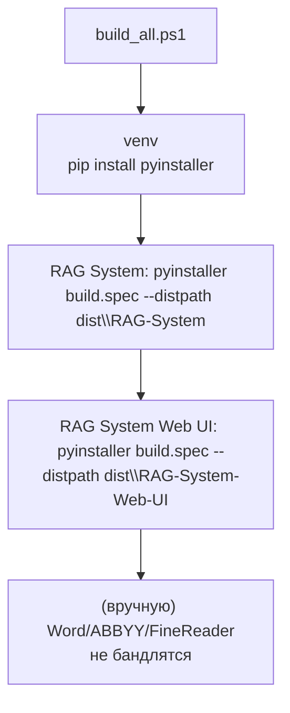

# 10. Сборка (PyInstaller)

Собираются обе программы как **onedir**-EXE в `dist/<имя>/`. Скрипт сборки — `build_all.ps1` в корне репозитория (при первом запуске ставит PyInstaller в venv проекта).

## 10.1 Общая механика

После сборки в `dist/` каталоги: `RAG-System/` (ядро) и `RAG-System-Web-UI/` (Web UI). В каждой — `_internal/` с бинарниками интерпретатора и зависимостей.

## 10.2 Ядро — `RAG System/build.spec`

- `Analysis(["app.py"], ...)`.
- `datas = collect_data_files("tiktoken_ext")` — **критично**: без них `ValueError: Unknown encoding cl100k_base` при подсчёте токенов (бинарные таблицы кодировок лежат в пакете `tiktoken_ext`).
- `hiddenimports`: `win32com`, `win32com.shell`, `win32com.client`, `pythoncom` (COM для Word/ABBYY).
- `hook_runtime.py` — `runtime_hooks`: перенастраивает `sys.stdout/-stderr` на UTF-8 (нативно вывод exe в cp1251, `-X utf8` у exe не задать).
- **Frozen-поведение**: `config_dir()` и cache_dir смотрят рядом с exe, т.е. `settings.json` и `.cache/` кладутся в `dist/RAG-System/`, а не в исходники.

## 10.3 Web UI — `RAG System Web UI/build.spec`

- `Analysis(["app.py"], ...)`.
- `datas`: папка `templates/`, `static/`, и `("../docx_templates/mmo.dotx", "docx_templates")` — шаблон попадает в `<exe_dir>/_internal/docx_templates/mmo.dotx`.
- `hook_runtime.py` выставляет env для frozen-режима:
  - `MEMO_TEMPLATE_DIR = <exe_dir>/_internal/docx_templates`,
  - `DATABASE_URL = sqlite:///<exe_dir>/data/app.db`,
  - `SECRET_KEY_FILE = <exe_dir>/data/secret_key`.
- **Данные пишутся рядом с exe** (не в `_internal`): `data/app.db`, `data/secret_key`.
- Корпус `out/` **не бандлится**: Web UI работает только через RAG API.
- `hiddenimports`: `docx`, `win32com.client` (для `memo_docx` / экспортных путей).

## 10.4 Порядок запуска собранных версий

1. Запустить ядро `dist\RAG-System\RAG_SR.exe` (или аналогичное имя exe).
2. Запустить `dist\RAG-System-Web-UI\...exe`. Web UI по умолчанию ждёт ядро на `http://127.0.0.1:11455/rag`.

## 10.5 Пост-сборочные проверки (ручные)

- `test_parse_all_docx_files` против собранного ядра не гоняется (COMDistributed) — проверяется выборочно один файл.
- Обязательно проверить: `settings.json` появился рядом с exe ядра; `data/app.db` создана у Web UI на первом запуске; скачивание `.docx` служебной записки работает (проверка `_internal\docx_templates\mmo.dotx`).
- Пропуск в сборке `python-docx` нельзя детектить по requirements (его там нет) — только ручной тест генерации `.docx`.

## 10.6 Известные «подводные камни»

- Версии `build.spec` синхронно с кодом не версионируются — после сноса зависимостей наберите в консоли ядра `rag_engine/rag_engine.py` версию (`VERSION`).
- Смена путей в `rag_engine/` (config_dir, cache_dir) после пересборки может ломать `test_parse_*`, даже если прод-конфиг не трогается.
- Если exe не находит `tiktoken_ext` — пересобрать с `collect_data_files("tiktoken_ext")`.